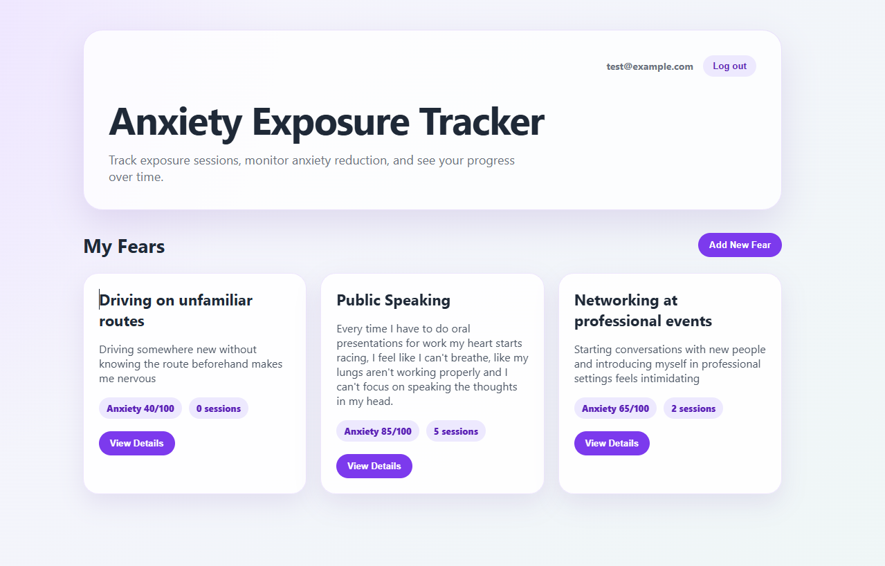
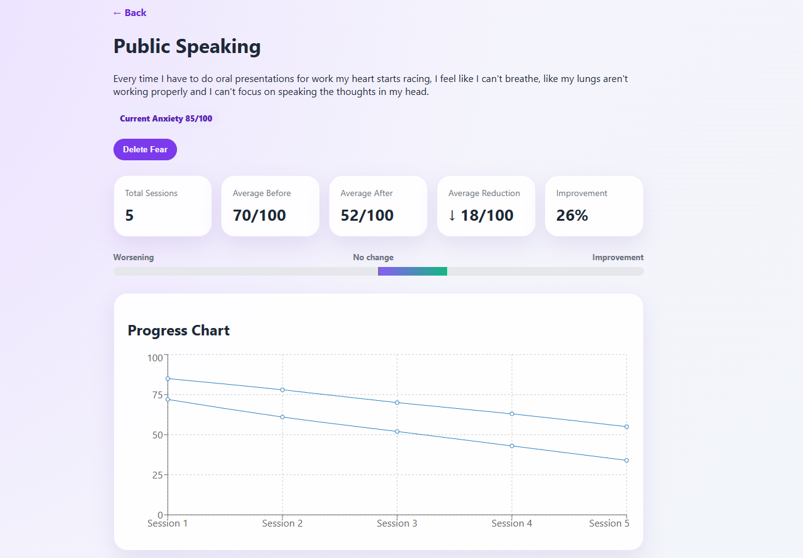
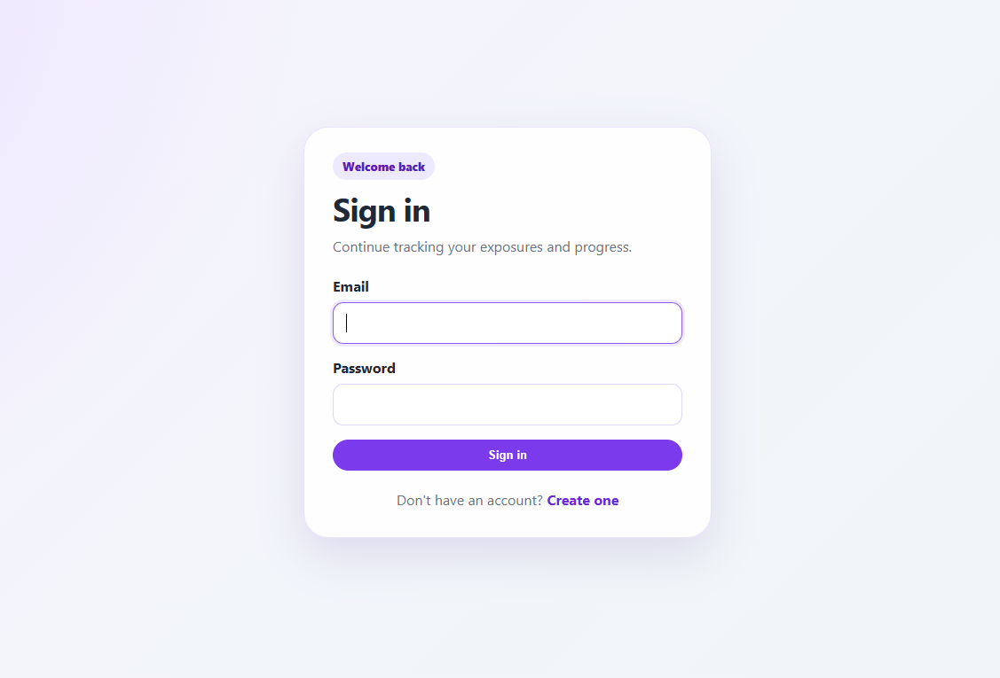

# Anxiety Exposure Tracker

A full-stack web application for tracking fears, recording exposure sessions, and visualizing changes in anxiety levels over time.

The project was built as an end-to-end full-stack application, with a React and TypeScript frontend, an ASP.NET Core Web API, PostgreSQL persistence, JWT-based authentication, and server-side per-user authorization.

## Live Application

**Live Demo:** https://anxiety-exposure-tracker.vercel.app

## Features

- User registration and login
- JWT-based authentication
- Protected application routes
- Create, view, update, and delete fears
- Record exposure sessions for individual fears
- Track anxiety levels before and after each exposure
- View exposure history
- Calculate average anxiety before and after exposures
- Calculate average anxiety reduction and improvement percentage
- Visualize progress over time with interactive charts
- Per-user data isolation
- Responsive interface for desktop and mobile
- Loading, validation, error, and retry states

## Tech Stack

### Frontend

- React
- TypeScript
- Vite
- React Router
- Axios
- Recharts
- CSS

### Backend

- ASP.NET Core / .NET 9
- C#
- Entity Framework Core
- ASP.NET Core Identity
- JWT Bearer Authentication
- REST API

### Database

- PostgreSQL
- Neon

### Deployment

- **Frontend:** Vercel
- **Backend:** Render
- **Database:** Neon PostgreSQL

## Architecture

The application follows a client-server architecture:

```text
React + TypeScript
        |
        | HTTPS / REST API
        v
ASP.NET Core Web API
        |
        | Entity Framework Core
        v
PostgreSQL / Neon
```

The frontend communicates with the ASP.NET Core API through Axios.

Authentication is handled using ASP.NET Core Identity and JWT bearer tokens. Authenticated API requests include the JWT in the `Authorization` header.

## Authentication & Authorization

Authentication and authorization are enforced by the backend rather than relying only on frontend route protection.

Each fear belongs to an authenticated user. Exposure sessions belong to fears and therefore inherit their ownership.

API queries verify ownership using the authenticated user's ID from the JWT claims. This prevents users from reading, modifying, deleting, or attaching exposure sessions to resources belonging to another account.

The authorization flow was tested against cross-user resource access, including direct ID-based requests.

## Progress Tracking

Each exposure session records:

- Anxiety level before the exposure
- Anxiety level after the exposure
- Date
- Optional notes

The application uses this data to calculate statistics including:

- Total exposure sessions
- Average anxiety before exposure
- Average anxiety after exposure
- Average anxiety reduction
- Improvement percentage

Progress is also displayed visually using Recharts.

## Screenshots

### Dashboard



### Fear Details & Progress



### Authentication



## Running Locally

### Prerequisites

Make sure you have installed:

- Node.js
- npm
- .NET 9 SDK
- PostgreSQL

### Backend

Navigate to the backend directory:

```bash
cd backend
```

Configure the database connection string and JWT settings using .NET User Secrets or environment variables.

Example configuration keys:

```text
ConnectionStrings:DefaultConnection
Jwt:Key
Jwt:Issuer
Jwt:Audience
```

Apply the database migrations:

```bash
dotnet ef database update
```

Run the API:

```bash
dotnet run
```

### Frontend

Navigate to the frontend directory:

```bash
cd frontend
```

Install dependencies:

```bash
npm install
```

Create a local environment file and configure the backend URL:

```text
VITE_API_BASE_URL=http://localhost:5228
```

Start the development server:

```bash
npm run dev
```

## Security Notes

- Password management is handled by ASP.NET Core Identity.
- Authentication uses JWT bearer tokens.
- Protected API endpoints require authentication.
- Resource ownership is validated server-side.
- Users cannot access another user's fears or exposure sessions through direct resource IDs.
- Production secrets and connection strings are provided through environment configuration and are not stored in the repository.
- Production CORS is restricted to the deployed frontend and the local development origin.

## Future Development

Planned future iterations include additional account-management functionality and anxiety-management tools such as guided breathing exercises.

## Author

**Marina**

Software Engineering graduate currently expanding my full-stack development portfolio through projects combining software development, data-driven interfaces, and behavioral/psychology-related applications.

## Repository

Source code: https://github.com/ariamarina0-commits/anxiety-exposure-tracker